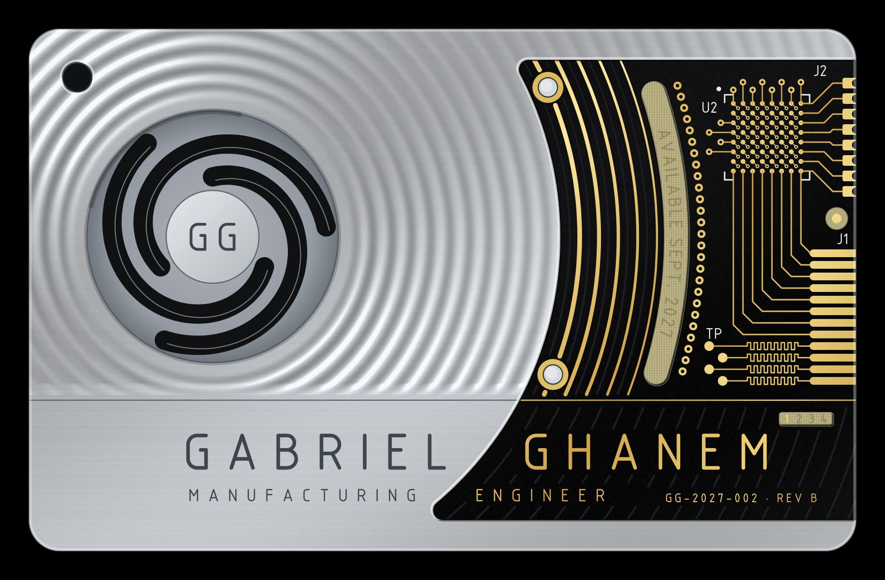
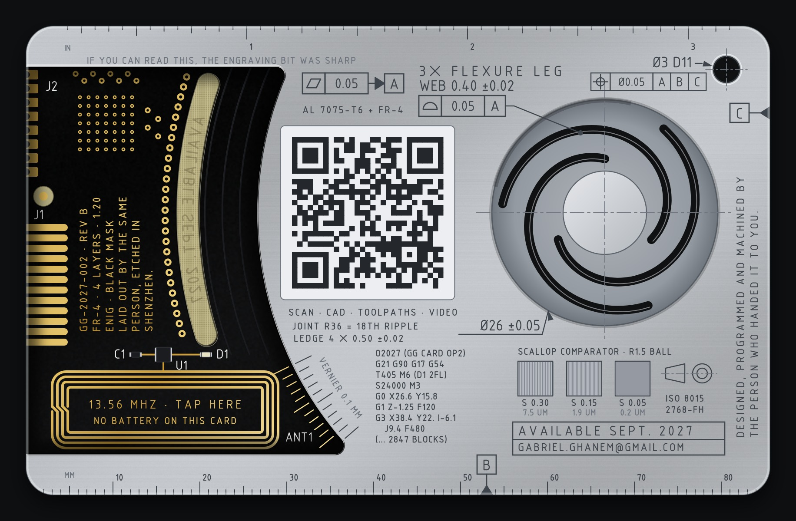
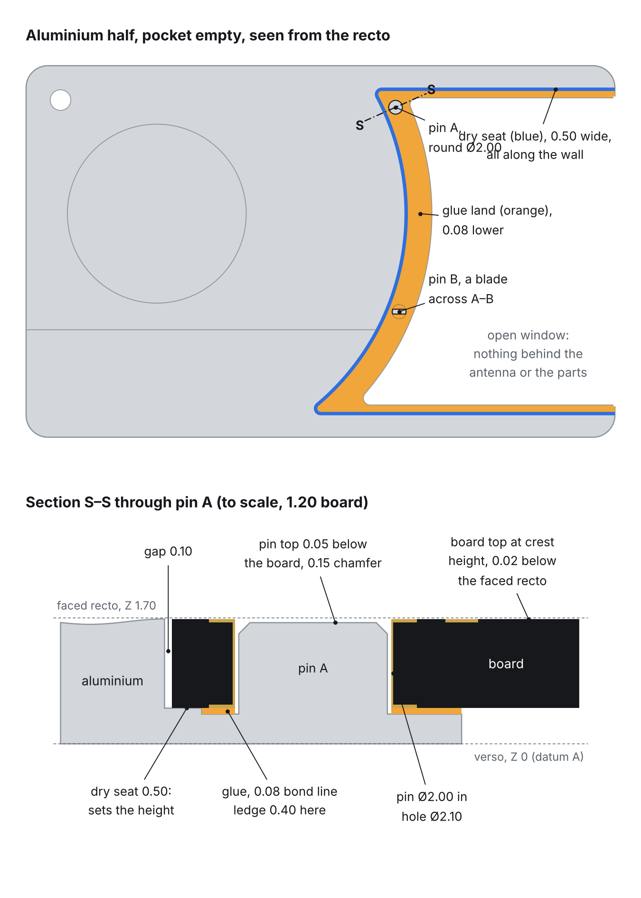

# Hybrid business card: milled aluminium + PCB

The second version of Gabriel Ghanem's CNC business card. One half is milled from 7075 aluminium on a hobby CNC,
the other is a four-layer circuit board, and the two meet along a ripple that spreads from the card's flexure.

| | |
|---|---|
|  |  |

- Card: 85.60 x 53.98 x 1.70 mm, corners R3.18.
- Aluminium half: 7075, engraved both faces, with the same flexure as the first card.
- Board half: 1.2 mm, black mask, gold finish, castellated holes on the free edge. It carries an NFC tag
  (NT3H2111): a phone held to the card opens the website, and the phone's field lights a red LED behind a slot
  in the board. There is no battery.
- Joint: the board sits in a pocket on a narrow ledge, located by two pins milled from the solid, flush with the
  ripple crests.

## Where things are

| Folder | What it holds |
|---|---|
| `design/hybrid/` | The mockups that set the look. `concept_b2.py` is the chosen direction ("Wavefront"). |
| `pcb/revA/` | The board, generated by Python scripts as a KiCad project. `out/order/` is the package for the fab: Gerbers, BOM, placement. |
| `cad/hybrid/` | The aluminium half as a STEP model, generated with CadQuery from the same numbers as the board, plus the fit gauge and the drawing of the joint (`interface.png`). |
| `lettering/` | The single-line ISOCP letters, as engraved on the first card. |

Each folder has its own README with the details: geometry and checks for the board in `pcb/revA/`, how the board
is held and what gets machined to the delivered boards in `cad/hybrid/`.

## Status

Rev A. The board has been through an independent audit and a pre-order review; both are recorded in
`pcb/revA/README.md`. The aluminium pocket is cut to the measured thickness of the delivered boards
(`python3 cad/hybrid/build_alu.py --board-t <measured>`), so the aluminium half is finalised once boards are in hand.

## Rebuilding

- Mockups: `python3 design/hybrid/generate.py b2` (numpy, pillow, shapely, segno, `rsvg-convert`).
- Board: `pcb/revA/build.sh` (KiCad's Python module `pcbnew` and `kicad-cli`, shapely, numpy, pillow, scipy, CadQuery).
  A rebuild rewrites the Gerber zip with new time stamps even when nothing changed.
- Aluminium: `python3 cad/hybrid/build_alu.py` (CadQuery, svgelements; `--engrave` adds the engraved model).

## The first card

The first card (all aluminium) and the website both cards point to are in
[CNC-Business-card-](https://github.com/Gabrielgorithme/CNC-Business-card-). The QR code on both cards opens
https://gabrielgorithme.github.io/CNC-Business-card-/, which is served from that repository.

The history of this repository starts on that repository's branch `claude/hybrid-card-mockups`; the commits were
moved here unchanged on 2026-11-25.
