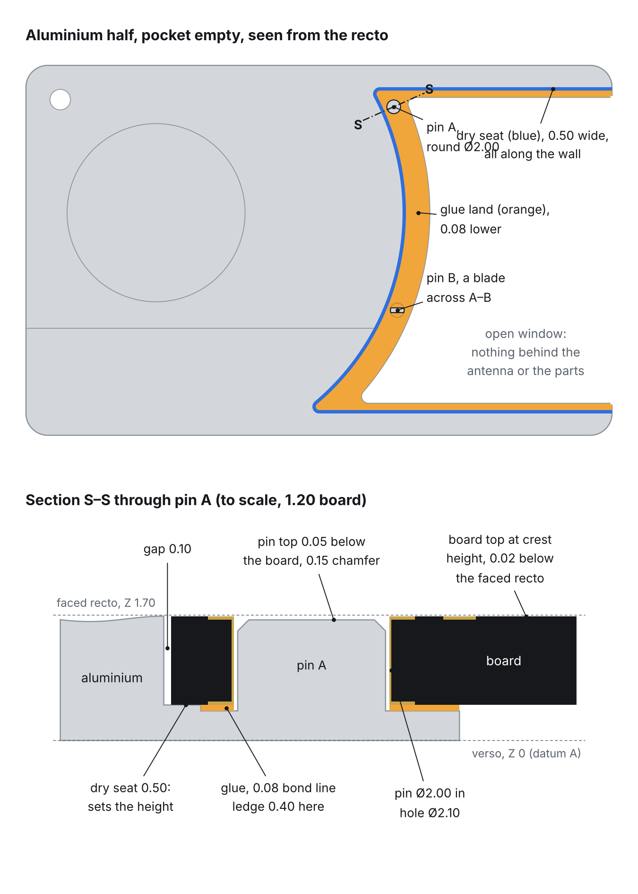

# Hybrid card, aluminium half, rev A

Machining geometry of the aluminium half (no engraving yet) and its assembly with the board from `pcb/revA/`.
Every interface number lives in `pcb/revA/gen_board.py`; the board and the aluminium are both drawn from it.

| File | What it is |
|---|---|
| `hybrid_card_revA_alu.step` | The aluminium half: outline, ripple field, flexure, hole, pocket, pins. |
| `hybrid_card_revA_assembly.step` | Aluminium + board + parts, in place. For Fusion. |
| `hybrid_card_revA_fit_gauge.step` | The pocket alone (no ripples, no flexure). Cut it in scrap first and try the boards in it. |
| `interface.png` | The interface in plan and in section. |
| `build_alu.py`, `interface_figure.py` | The generators. `build_alu.py` also measures the fit on the two solids. |

Frame: X along the long edge, Y up as seen from the recto, origin at the card's bottom-left corner,
Z = 0 the verso (datum A), Z = 1.70 the faced recto.

## How the board is held

1. **Height: one dry seat.** A land 0.50 wide runs along the foot of the pocket wall, on all three sides. The board
   rests on it, metal to solder mask, with no glue in between, so the step you see at the joint depends on one
   machined depth and nothing else. The board keeps its copper 0.60 from its edge, so the seat always meets flat mask.
2. **Glue: its own land.** The rest of the ledge is 0.08 lower. That is the bond line, and it clears the copper on the
   board's back (text ladders, pin lands). Excess runs towards the window, where it can be wiped from the back,
   not towards the joint.
3. **Position: two pins milled from the solid.** Pin A is round, Ø2.00 in a Ø2.10 plated hole. Pin B is a blade,
   2.00 across the line A–B and 0.70 along it: it stops rotation and leaves ±0.12 for the hole-to-hole distance.
   Two round pins would fight each other as soon as the fab's drilling and the mill disagree by 0.1.
   Pins have a 0.15 lead-in chamfer and stop 0.05 below the board's top face.
4. **Sides: 0.10 gap** to the wall all round. The pins set the position; the walls never touch the board.
5. **Top face.** The ripple crest that forms the joint is 0.02 below the faced recto (as on v1, so crests get cut too).
   The board's top face is put at that crest height: flush with the wave it continues, 0.02 below the flat name band
   and bottom rim. It is never proud.
6. **Free edge.** The board stops 0.10 inside the card's right edge, so the fab's outline tolerance cannot make it
   stand proud of the aluminium there.
7. **Radio.** Behind the antenna and the parts there is no aluminium at all, and the aluminium is a C open on the
   right, not a closed ring around the coil.

Measured on the two solids by `build_alu.py` (1.20 board): interference 0, wall gap 0.100, pin clearance 0.050 each,
bond line 0.080, dry seat 51.6 mm², nearest part to aluminium 2.45, ledge 0.48 under the seat and 0.40 under the glue.
Checked on the board file: no copper on the seat, and nothing of the tag circuit over the ledge
(decorative copper only).

## What is cut to the delivered boards

JLCPCB's published tolerances are larger than the fits above, so three numbers come from the boards, not from the model.

| Measure on the boards | Fab tolerance to expect | It sets |
|---|---|---|
| Thickness, at the joint edge | ±10 % (1.08 to 1.32) | Seat depth below the crest plane = thickness. `python3 build_alu.py --board-t 1.17` rebuilds everything for 1.17. |
| The two hole diameters | +0.13 / −0.08 | Pin diameter = smallest hole − 0.06. |
| Width between the rims (47.42 nominal) and the joint radius | ±0.2, or ±0.1 with the precision routing option | Wall offset, to keep 0.10 per side. |

Seat height is 1.68 − thickness, so the ledge is 0.48 for a 1.20 board and 0.41 for a 1.27 one. The parts on the back
are 0.50 tall: their lowest face is at seat − 0.50, i.e. 0.02 below the verso plane for a 1.20 board, plus the solder.

## Machining notes

- Pocket corners are R1.0 (R0.5 at the seat step). Finish them with a cutter of Ø1.5 or less; a Ø2 cutter would
  have to plunge into the corner at full engagement.
- The seat is the surface that matters. Cut it and the wall with a cutter whose corners are still sharp, and break
  the bottom edge of the board with one stroke of fine paper, so a corner radius or a routing burr cannot lift it.
- The rims are 3.18 × 1.70 and 36 and 46 mm long. Leave them tabbed, or cut the window last.
- Do the verso first, at full stock thickness. Its engraving reaches the ledge (the QR corner, the vernier): a
  0.10 engraving over the glue land leaves 0.30.
- Glue with a slow epoxy, in small beads on the glue land, away from the seat. Cyanoacrylate fumes leave a white
  bloom on black solder mask.
- Tune the antenna (solder bridges, see `pcb/revA/README.md`) with the board seated on the pins, before gluing.
  The bridges stay reachable through the window afterwards.

## Not in this model yet

Engraving, recto and verso. The verso mock-up carries the note "LEDGE 4 × 0.50 ±0.02"; with the ledge now cut
to the boards, that note should become the thing that is actually held: the step between board and aluminium.
